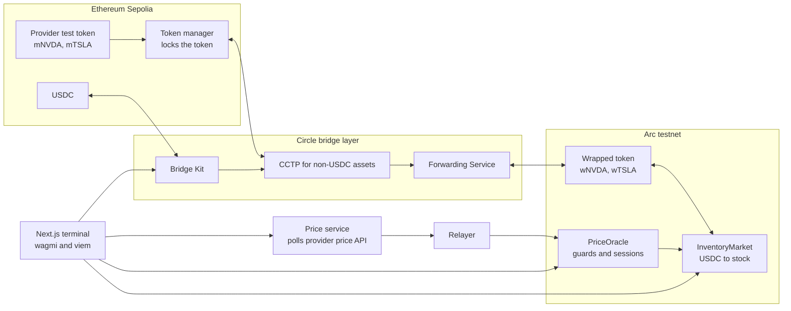

# Arcusa

**Bringing US stocks to Arc.** A stock terminal for non-US users: fund with USDC, bridge a provider's stock token in with Circle, and trade it against USDC on Arc.


## ETHGlobal Mumbai submission

**Bounties we are submitting for**
1. **Best Use of Bridge Kit for Non-USDC Assets, Built in Arc Studio** (main).
2. **Best DeFi / Onchain Finance App Built End to End in Arc Studio** (same project; a trading app with tokenized stocks and USDC settlement).

| | |
| --- | --- |
| Arc Studio project | https://studio.arc.io/app/efb4a3b8-92a8-41d3-993a-5d254dc32258 |
| Live app | https://arcusa-alpha.vercel.app/ |
| Presentation | [add link] |
| Architecture diagram | [below](#architecture) |
| Docs in the app | `/docs` (how it works, bridge, oracle, contracts, risks, gas costs, FAQ, roadmap) |

This is a **testnet demo**. The stock tokens are test tokens, the prices are indicative, and there are no real shares and no real value.

## What it does

- **Bridge in.** USDC goes from Ethereum Sepolia to Arc with Bridge Kit and the Forwarding Service, so the user pays no gas on Arc.
- **Bring a stock token across.** A provider's stock token is locked on its home chain (Sepolia) with Circle's CCTP for non-USDC assets, and a wrapped token is minted on Arc. Locked on Sepolia always equals the wrapped supply on Arc.
- **Trade.** The terminal quotes the stock in USDC from an on-chain oracle and trades against pre-positioned inventory on Arc. Price, market session and oracle age are shown, and every order shows fee, spread and the amount received.
- **Bridge out.** The wrapped token goes back from Arc to Sepolia with Bridge Kit as one visible flow.
- **Many providers, one terminal (direction).** The design is an aggregator: the same stock can exist as several provider tokens on Arc, and the terminal compares them and shows the best price. Today each stock has one provider token; the comparison view is in progress, so check [TASKS.md](./TASKS.md) and the app's `/docs/roadmap` page for what is built.

Stocks live today: **NVDA** and **TSLA** (test tokens `mNVDA`/`wNVDA` and `mTSLA`/`wTSLA`).

## Architecture



Reading it left to right: Sepolia holds the real provider token and locks it, Circle's bridge layer moves it, and Arc holds the wrapper, the market and the oracle. The terminal talks to both chains and the price service.

## Circle and Arc tools used

| Tool | How we use it |
| --- | --- |
| **Arc Studio** | Wrote, tested and deployed the oracle and market contracts. See [Built in Arc Studio](#built-in-arc-studio). |
| **Bridge Kit** | Moves USDC and the wrapped stock token, by token id, in both directions. |
| **CCTP for non-USDC assets** | Ownerless lock-and-wrap path for provider tokens (Sepolia home chain, wrapper on Arc). Tokens are registered permissionlessly on testnet. |
| **Forwarding Service** | `useForwarder: true` on every route. Circle submits the destination transaction, so no destination gas for the user. The fee is not itemised by Bridge Kit yet (it returns `fees: null` for the stock-token legs). |
| **USDC on Arc** | Settlement currency and gas. |

Measured on testnet (see [LOG.md](./LOG.md), spike T-024): Sepolia to Arc takes about 16 minutes at standard speed (Sepolia finality), and Arc to Sepolia takes about 28 seconds. Fast Transfer was not verified and reverts in simulation for these tokens.

## Price parity

A wrapped stock can drift from the real one, so the price is bounded, not guaranteed.

- **Source:** the provider's price API (xStocks) is the first choice. The relayer reads it and pushes the price to the on-chain `PriceOracle`. Chainlink and Pyth are the planned fallback sources and are not built.
- **Guards in the contracts:** staleness limit, confidence check, per-update deviation cap, market-session aware spread, trade caps and inventory limits. The market also reverts when the quote is stale.
- **Off-hours:** US regular hours (20:00 to 02:30 IST) are the only session with a firm price. Outside it the demo trades at the last price with a wider spread and labels the price indicative.

Details and the full control table: [ADR 0015](./docs/adr/0015-price-parity-and-off-hours-policy.md).

## Built in Arc Studio

Arc Studio project (shareable): https://studio.arc.io/app/efb4a3b8-92a8-41d3-993a-5d254dc32258

What was built where, plainly:

| Part | Where it was built |
| --- | --- |
| `PriceOracle` and `InventoryMarket` contracts, their Foundry tests (101 passing as reported by Studio) and four testnet deployments (NVDA and TSLA oracle and market) | **Arc Studio** (Smart Contract mode, driven with the Arc Studio CLI). Output is in [`contracts/arc/studio/`](./contracts/arc/studio/); addresses in [`deployments/arc-testnet.json`](./deployments/arc-testnet.json) under `studio`. |
| Trading app (Next.js), bridge page, docs | Written in this repo. The Studio project also holds an earlier UI scaffold (Vite). |
| Mock stock tokens on Sepolia, wrapped tokens on Arc | Deployed by script; the wrapped tokens use Circle's CCTPx ownerless token manager. |
| Price service and oracle relayer | Written in this repo (`services/price`), run on a server. |

Status today: the app trades against the Studio-deployed contracts (NVDA and TSLA oracle and market, built, tested and deployed in Arc Studio, ADR 0025). The first, script-deployed set is superseded and kept under `superseded` in [`deployments/arc-testnet.json`](./deployments/arc-testnet.json). Real buys and sells on both stocks were run against the Studio markets on 2026-11-07 (hashes in [LOG.md](./LOG.md)).

## What is real and what is mocked

| Real on testnet | Mocked or simplified |
| --- | --- |
| Bridge Kit and CCTP transfers in both directions, with Forwarding | `mNVDA` and `mTSLA` are our own test tokens standing in for provider tokens |
| Oracle and market contracts on Arc, with real buys and sells | The price comes from a public price endpoint through our trusted relayer, and is indicative |
| Locked equals wrapped accounting after a round trip | Trades fill from pre-positioned inventory, not from a live order book |
| Live price service and relayer | No KYC or compliance layer ([ADR 0016](./docs/adr/0016-compliance-provider-tokens.md)); provider comparison beyond one provider per stock is not built |

We do not issue stocks. Provider tokens (xStocks, Ondo and similar) plug into the same lock-and-wrap path ([ADR 0012](./docs/adr/0012-provider-token-lock-and-wrap.md)).

## Run it

Requires Node 22.12 or newer and pnpm.

```bash
pnpm install
pnpm --filter @arcusa/app dev          # the terminal, http://localhost:3000
pnpm test                              # bridge package unit tests (vitest)
```

The price service has no dependencies:

```bash
cd services/price && node server.mjs   # Node 22.5 or newer; see services/price/README.md
```

Environment variables are names only in [`.env.example`](./.env.example): `DEPLOYER_PRIVATE_KEY`, `RELAYER_PRIVATE_KEY`, `ARC_TESTNET_RPC_URL`, `SEPOLIA_RPC_URL`, `IRIS_API_URL`, `FMP_API_KEY`, `NEXT_PUBLIC_WALLETCONNECT_PROJECT_ID`. Copy it to `.env` and fill it locally. Never commit `.env`. The app itself needs no secrets, only the WalletConnect project id if you want that connector.

To use the app you need a wallet with Sepolia USDC (Circle faucet) and some Sepolia ETH, and Arc testnet added (the app adds it for you).

## Repo layout

| Path | What |
| --- | --- |
| `app/` | Next.js trading terminal, bridge page and docs pages |
| `packages/bridge/` | Bridge layer around Bridge Kit, with unit tests |
| `contracts/arc/` | Oracle and market contracts; `studio/` holds the Arc Studio output and tests |
| `contracts/sepolia/` | Mock provider tokens and Sepolia-side Foundry project |
| `contracts/scripts/` | Spike, deploy and check scripts |
| `services/price/` | Price service and oracle relayer |
| `deployments/` | Deployed addresses and transaction hashes |
| `docs/adr/` | Architecture decision records ([index](./docs/adr/README.md)) |
| `docs/runbooks/` | Deploying a new wrapped token |

## Deployed (testnet)

Arc testnet (chain id 5042002), Studio set used by the app (built and deployed in Arc Studio):

| Contract | Address |
| --- | --- |
| wNVDA | `0x5ad2862787d5C7F42a09014CE4C973d162878a16` |
| wTSLA | `0xD6bB2FFfCc37845fe44767E40569b801c9F9afd5` |
| PriceOracle (NVDA) | `0x8503bb2d15f88bb31a9363bc0dfbe9391028ebda` |
| InventoryMarket (NVDA) | `0x0e0d70183cfdf6192e0f43cea39d5567f3698d13` |
| PriceOracle (TSLA) | `0x1b53204d9d873b74760fd1933e8151220995de05` |
| InventoryMarket (TSLA) | `0x3fb35049ebee5618538214bb504743cdf4f0b5f2` |

Ethereum Sepolia: `mNVDA` `0xecD2332b5E119C0a34dbd80043EC54cd1a9B7423`, `mTSLA` `0xbd0ae58afe2d6c42a3b31f8d97b31093fcbc8bdf`.

The first, script-deployed set is superseded (same source, no longer used by the app). Both sets, with transaction hashes, are in [`deployments/arc-testnet.json`](./deployments/arc-testnet.json).

## Feedback for Arc and Circle

Problems we hit with the tooling and docs, with dates and suggested fixes, are in [FEEDBACK.md](./FEEDBACK.md).

## More

- [PLAN.md](./PLAN.md): goal, facts and open questions
- [TASKS.md](./TASKS.md): task list and results
- [LOG.md](./LOG.md): dated working log with the measured numbers
- [docs/adr/](./docs/adr/): decisions
